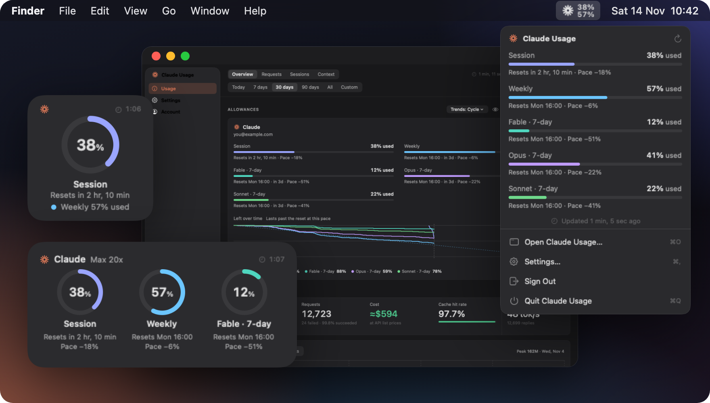
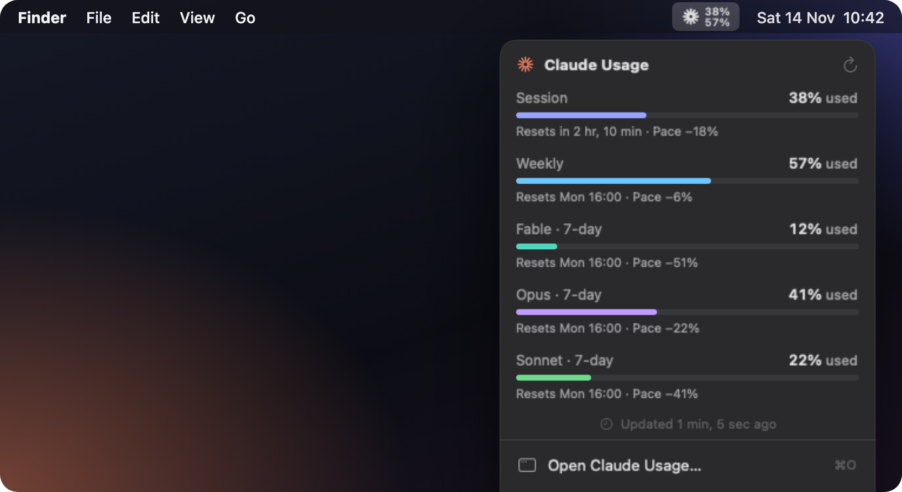
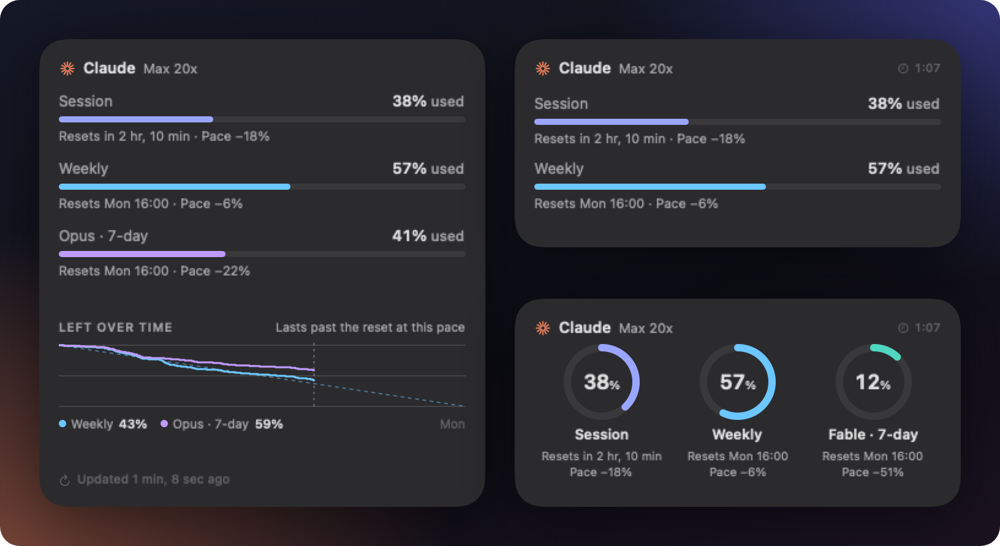
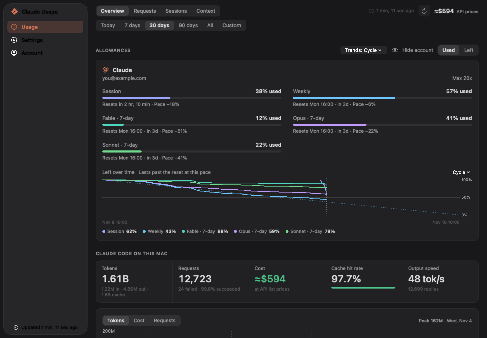
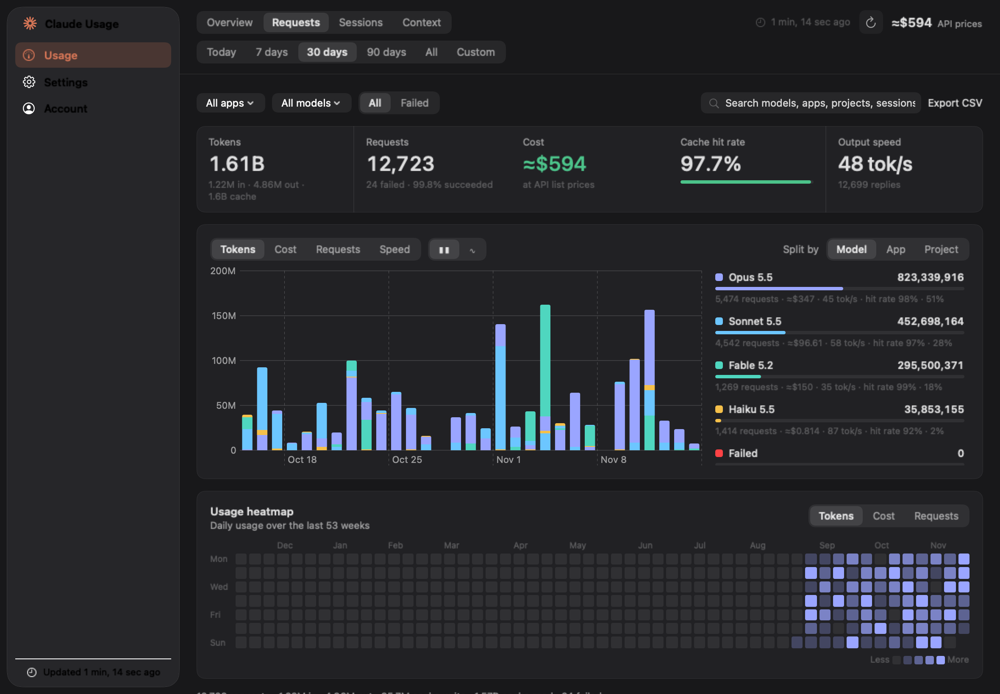
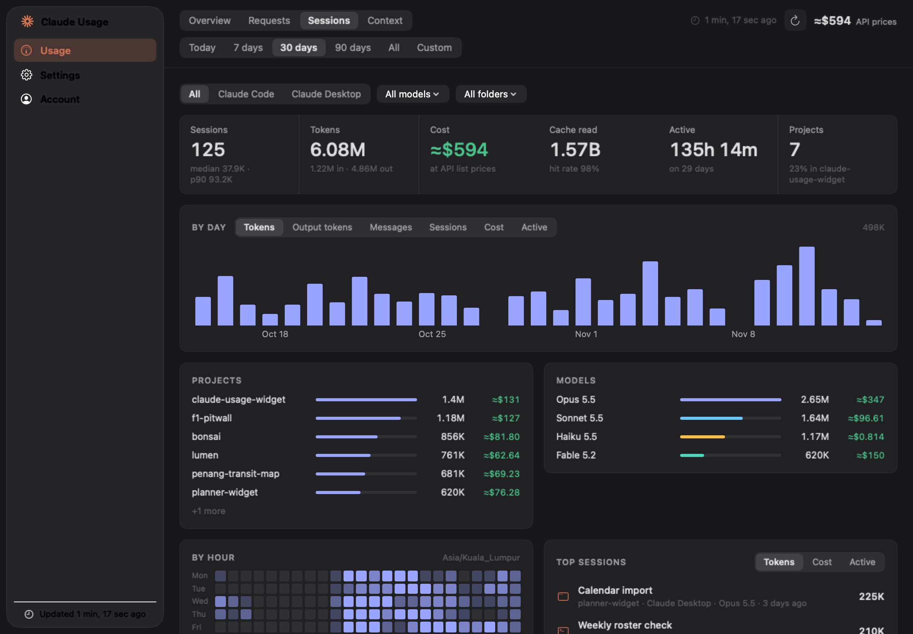
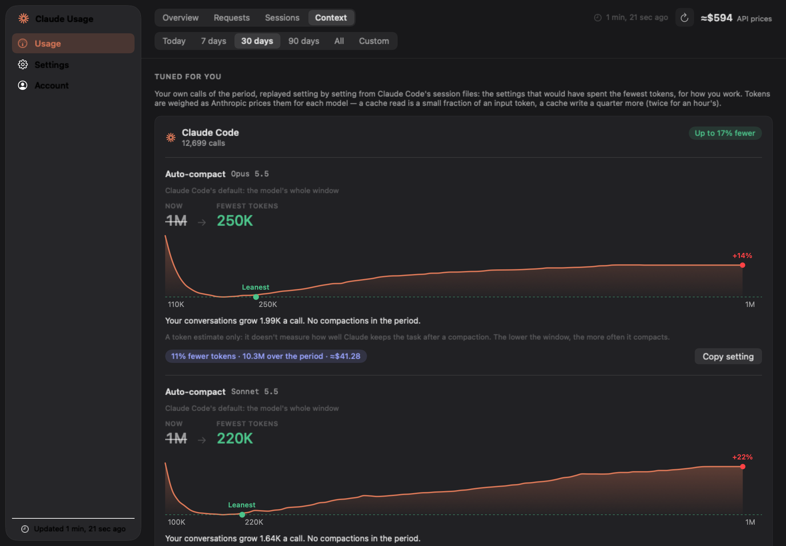

<div align="center">


# Claude Usage

**Your Claude plan limits, on your Mac.**<br>
Session and weekly limits in the menu bar and on your desktop, with reset countdowns, pace and a forecast, plus Claude Code's token activity.

macOS 15+ &nbsp;—&nbsp; menu bar app and WidgetKit widgets

[](#install)
[](project.yml)
[](LICENSE)
[](https://github.com/sponsors/MarcusLai07)

<br>



</div>

Claude subscriptions have rolling limits, a 5-hour **session** window and a 7-day **weekly** window, but checking them means opening Claude Code or claude.ai. Claude Usage keeps them where you can see them.

> [!NOTE]
> **Unofficial.** It reads the same undocumented endpoint Claude Code uses for `/usage`, which may change or stop working without notice. Not affiliated with Anthropic.

## Install

Build from source. Needs macOS 15+, Xcode 16+, and a Claude Pro, Max or Team subscription.

```bash
brew install xcodegen
git clone https://github.com/MarcusLai07/claude-usage-widget.git
cd claude-usage-widget
xcodegen generate
open ClaudeUsage.xcodeproj
```

In Xcode, pick your team under *Signing & Capabilities* for **both** targets (a free personal team works), then run. If Xcode complains about the app group or keychain group, replace `com.marcuslai` with your own identifier in `project.yml` and `Shared/AppGroupStore.swift`, and run `xcodegen generate` again.

<details>
<summary><b>Build from the terminal, and why there's no download</b></summary>

<br>

After the one-time team setup in Xcode:

```bash
xcodebuild -scheme ClaudeUsage -configuration Debug \
  -allowProvisioningUpdates -derivedDataPath build.noindex build
ditto build.noindex/Build/Products/Debug/ClaudeUsage.app /Applications/ClaudeUsage.app
open /Applications/ClaudeUsage.app
```

**Why no download?** Zips on [Releases](https://github.com/MarcusLai07/claude-usage-widget/releases) are development-signed, and macOS refuses to run them on any Mac but the author's. Distributable builds need a paid Developer ID certificate and notarization; until then, build from source. (Right-click → Open won't help: the provisioning profile is tied to one device.)

**Free team?** Apps with an app group get a 7-day provisioning profile from a free team. When it lapses the app stops launching and the widgets go blank; build and install again to renew it.

</details>

### First run

1. The app lives in the **menu bar** (gauge icon), with no Dock icon.
2. **Sign in** from its window (menu bar → Open Claude Usage), through the browser or by importing Claude Code's existing sign-in from your keychain in one click.
3. Add widgets: right-click the desktop → *Edit Widgets* → search "Claude Usage". Two styles, three sizes each.
4. For token activity, open **Usage** and grant access to `~/.claude` once. The app only reads it.

## What it does

<table>
<tr>
<td width="50%" valign="top">

<br><b>Menu bar.</b> Session over weekly percentages at a glance; click for every limit with its reset and pace, a manual refresh and when it last updated.
</td>
<td width="50%" valign="top">

<br><b>Desktop widgets.</b> Progress bars or radial rings in small, medium and large, with live reset countdowns. The large bars widget adds the week's curve and forecast.
</td>
</tr>
<tr>
<td valign="top">

<br><b>Allowances, pace and a forecast.</b> Each limit's figure, reset and pace, and a left-over-time chart per cycle with an even-pace line and when you'd run out. Below it, Claude Code's tokens by app, model and project.
</td>
<td valign="top">

<br><b>Every request.</b> Each Claude Code call with its model, tokens, cache and cost, a chart of the period and a heatmap of when you work. Exports to CSV.
</td>
</tr>
<tr>
<td valign="top">

<br><b>Sessions.</b> Sessions by day, by project and model, your busiest hours of the week, and the top sessions by tokens, cost or time, each opening its requests.
</td>
<td valign="top">

<br><b>Tuned for you.</b> Replays your own calls at every auto-compact window and both prompt-cache lifetimes, and suggests the setting that would have spent the fewest tokens.
</td>
</tr>
</table>

<details>
<summary><b>Everything else</b></summary>

<br>

- **Notifications** when usage crosses thresholds you set (50–95%, separately for session and weekly), when a limit is reached, when the week is on pace to run out early, and before a weekly reset with much of it unused. Each fires at most once per window.
- **Metrics you choose:** Session, Weekly, Fable 7-day, Opus 7-day, Sonnet 7-day and Extra usage (prepaid credits), with a Used / Left switch.
- **Costs** for Claude Code's calls, at each model's Anthropic API prices.
- **Reading your usage costs zero Claude tokens.** The endpoint is account metadata and never runs a model. The app checks every 5 minutes, and the app and all widgets share one fetch.

</details>

## Where the numbers come from

| | Limit percentages | Token activity |
|---|---|---|
| **Source** | `api.anthropic.com/api/oauth/usage` (what Claude Code's `/usage` shows) | Local transcripts in `~/.claude/projects` |
| **Covers** | Your whole account: every device, claude.ai, mobile | Claude Code on **this Mac only** |
| **Detail** | Percent used and reset time per window | Exact tokens per call, per model |

The two don't convert into each other: Anthropic weighs models differently in its limit math, so token counts can't become percentages. The percentages are the source of truth.

<details>
<summary><b>FAQ</b></summary>

<br>

**A metric shows "—" or "no data yet".** Anthropic isn't reporting that window for your account (e.g. `seven_day_opus` is often `null` until you've used Opus that week). It appears once reported. Pro plans report fewer windows than Max.

**The left-over-time chart is mostly empty.** History is recorded going forward, one sample per 5 minutes while the app runs; there's no history to backfill from. It fills in within a day or two, and the forecast needs an hour of readings this cycle.

**I use Claude on two Macs.** Percentages already include both. Token activity is per Mac: run the app on each to see each one's Claude Code use.

**Widgets lag a little.** WidgetKit refreshes when it chooses (up to ~15 min). The menu bar and window are live.

**Which tokens count.** Totals are input (with cache writes) plus output. Cache *reads* are counted apart, in the stat strip and Requests: they're ~90% of raw volume and cheap.

**Why does the sign-in page say "Claude Code"?** Anthropic doesn't offer OAuth registration for third-party apps, so Claude Usage signs in through Anthropic's own public Claude Code client, as other community usage tools do. The token is exchanged locally and kept only in your keychain.

</details>

## Privacy

- Sign-in tokens live **only in the macOS keychain** (the data-protection keychain, shared with the widget so it can refresh on its own). Never in files, defaults or logs.
- The app is **sandboxed** and only talks to `api.anthropic.com`, `claude.ai` and `console.anthropic.com`.
- `~/.claude` is read locally through a folder grant you can revoke. Nothing is uploaded. (The sandbox allows writing only to files you pick, for the CSV export.)
- Fetch timings, CPU and memory go to a local log so polling cost can be checked. It never leaves your Mac:

```bash
jq -s 'group_by(.source)[] | {source: .[0].source, n: length, avgMs: (map(.durationMs) | add/length)}' \
  ~/Library/Group\ Containers/P7DV5ZUK9A.com.marcuslai.ClaudeUsage/perf-log.jsonl
```

## Support

Claude Usage is free and open source. If it's saved you a surprise limit, you can chip in from anywhere, by card: [**❤ Sponsor on GitHub**](https://github.com/sponsors/MarcusLai07). Thank you!

<details>
<summary><b>For developers</b></summary>

<br>

```
App/                     Menu bar app and main window (SwiftUI)
  Analytics/             Transcript parsing (incremental, per-file cache), costs,
                         context tuning, ~/.claude folder access
  Views/                 Window (Usage: overview, requests, sessions, context;
                         settings, account), popover, onboarding, components
Widget/                  WidgetKit extension: two widget kinds, three sizes
Shared/                  OAuth (PKCE), keychain token store, usage API client,
                         fetch coalescing, usage history and trends, models, theme
Shots/                   Offscreen renderer for the README screenshots
Scripts/                 Icon generator, release packaging, screenshots
project.yml              XcodeGen project (the .xcodeproj is generated)
```

Notes that save you a debugging session:

- Tokens must live in the **data-protection keychain**: widgets can't show the login keychain's consent prompt, so file-based keychain items are unreadable from the extension.
- **Bump `CURRENT_PROJECT_VERSION`** whenever widget configurations change; the widget gallery caches descriptors by bundle version.
- All fetches go through one coalescing actor: the usage endpoint returns **HTTP 429** under bursts, which every placed widget fetching on its own would cause.
- Build into `build.noindex/` (Spotlight skips `.noindex` folders) so build products don't show up as duplicate apps in Launchpad.

**README media:** `Scripts/shot.sh` builds the `ClaudeUsageShots` tool, which renders the app's and widget's real views offscreen with sample data into `docs/media/` (no window on screen, and no network, keychain or `~/.claude`). Name shots to render only those, e.g. `Scripts/shot.sh popover window-usage`. `hero.png`, `menubar-popover.png`, `widgets.png` and `social.png` are arranged from those shots.

**Roadmap:** Developer ID signing and notarization (downloads that just work) · per-widget configuration (App Intents) · launch at login · merging several accounts or Macs.

</details>

<br>

<sub>Not affiliated with Anthropic. MIT licensed. The app icon and sunburst mark are generated by `Scripts/GenerateIcon.swift`.</sub>
